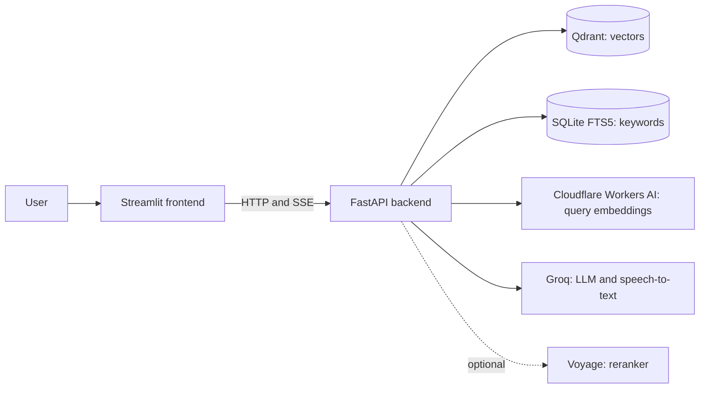

# MedHelp
 
**A clinical-guideline assistant that answers questions only from published, open-access guidelines, with citations, the guideline's own evidence grades, and an automatic check that each cited statement matches its source.**
 
MedHelp is a Retrieval-Augmented Generation (RAG) application built from two independent modules: a **FastAPI backend** and a **Streamlit frontend**. Users ask questions in plain language (typed or spoken); the backend retrieves the relevant guideline passages, has a language model write an answer grounded in them, and verifies the result before returning it.
 
> **Educational use only.** MedHelp summarises published clinical guidelines. It is not medical advice, does not diagnose or recommend treatment for individuals, and does not replace a qualified healthcare professional. Requests for personal medical advice are refused before any search or model call is made.
 
Version **2.0.0**
 
---
 
## Table of contents
 
1. [Features](#features)
2. [Architecture](#architecture)
3. [Tech stack](#tech-stack)
4. [Project structure](#project-structure)
5. [Getting started](#getting-started)
6. [Configuration](#configuration)
7. [Using the application](#using-the-application)
8. [API reference](#api-reference)
9. [Testing](#testing)
10. [Security and privacy](#security-and-privacy)
11. [Known limitations](#known-limitations)
12. [Troubleshooting](#troubleshooting)
13. [Data sources and license](#data-sources-and-license)
---
 
## Features
 
### Grounded, verifiable answers
- **Answers come only from the guideline library.** The model is instructed to use the retrieved passages and nothing else, and to say so when they do not contain the answer.
- **Numbered citations** in the form `[Document, Page X]`, linked to the original document where a URL is known.
- **Evidence grades preserved verbatim**: Class of Recommendation, Level of Evidence, GRADE strength and certainty, and CDC categories are copied as written and then checked against the retrieved text. A final *Strength of Recommendation* line summarises them.
- **Citation verification**: each cited sentence is compared with the passage it cites (content words and every number). Results are reported as `supported`, `partial`, `unsupported` or `source_not_found`, with the closest matching sentence shown as evidence. A sentence that cites several passages is judged against their combined text.
- **Plain-language glossary** of the technical terms used in each answer.
- **Suggested follow-up questions** after every answer.
### Retrieval
- **Hybrid search**: semantic vector search (Qdrant) combined with keyword search (BM25 on SQLite FTS5), merged with reciprocal-rank fusion.
- **Bibliography filtering** keeps reference lists out of results.
- **Optional reranking** of the best candidates through an API reranker (no local model required).
- **Follow-up understanding**: short follow-ups such as "what about children?" are rewritten into standalone questions using the conversation history.
### Conversation and comparison
- **Per-session history on the server.** Each browser tab has its own session; sessions are isolated, size-bounded and expire automatically. A page refresh resumes the conversation.
- **Compare mode**: ask one question across two or three publishers and receive a structured answer (*where they agree*, *where they differ*, *only one covers*, *strength of recommendation* per publisher).
### Interaction
- **Real token streaming** over Server-Sent Events, with a non-streaming endpoint for simple clients.
- **Voice questions**: record, review an editable transcript, then send. Speech recognition runs on Groq Whisper; audio is never stored.
- **Export** of any conversation to Markdown or PDF, with numbered references and the passages consulted.
### Safety and operations
- **Medical guardrail**: personal diagnosis or treatment requests receive a fixed refusal; self-harm statements receive a supportive response. Neither triggers retrieval or a model call.
- **Semantic answer cache** for repeated or near-identical questions, scoped by mode, with protection against caching ambiguous follow-ups.
- **Fair-use controls**: per-client rate limiting and a bounded request queue.
- **Optional API-key protection** between frontend and backend.
- **Health endpoint** reporting readiness, keyword-index state, memory use, queue depth and cache statistics.
---
 
## Architecture
 

 
MedHelp has an **offline** phase and an **online** phase:
 
| Phase | What happens |
|---|---|
| **Ingestion** (offline, run on your own machine) | PDFs are read page by page, cleaned, split into chunks of about 512 tokens, embedded with `BAAI/bge-large-en-v1.5` and written to Qdrant. The same run writes `backend/data/keyword.sqlite.gz`, the keyword index. |
| **Serving** (online) | The backend embeds only the user's short question, searches Qdrant and the keyword index, generates a grounded answer, checks it and returns it. |
 
Keeping heavy work (PyTorch, the embedding model, PDF parsing) in the offline phase keeps the runtime backend small.
 
### The question pipeline
 
1. **Small talk**: greetings, thanks and "what can you do?" receive a canned reply.
2. **Medical guardrail**: personal medical advice requests are refused.
3. **Follow-up rewriting**: follow-ups are turned into standalone questions using session history.
4. **Embedding**: the question is embedded once; the vector serves the cache lookup and the search.
5. **Cache lookup**: a near-identical earlier question in the same mode is answered from the cache.
6. **Hybrid retrieval**: semantic and keyword search, bibliography filtering, fusion, optional reranking, packing into the context budget.
7. **Grounded generation** (streamed if requested).
8. **Post-checks**: refusal detection, citation presence, evidence-grade verification, per-sentence citation verification.
9. **Glossary and follow-ups**: two helper-model calls run in parallel.
10. **Cache and session update.**
### Runtime state
 
Sessions, the answer cache and rate-limit counters live in the memory of the backend process. Run the backend as a **single process** (`--workers 1`); additional processes would not share this state. When the process restarts, sessions are lost, and the frontend transparently re-sends its own copy of the conversation once.
 
---
 
## Tech stack
 
| Layer | Technology |
|---|---|
| Frontend | Streamlit 1.40+ |
| Backend | FastAPI, uvicorn, pydantic v2 |
| Answer model | Groq `openai/gpt-oss-120b` |
| Helper model | Groq `openai/gpt-oss-20b` (glossary, follow-ups, query rewriting) |
| Speech-to-text | Groq `whisper-large-v3-turbo` |
| Embeddings | `BAAI/bge-large-en-v1.5`, through Cloudflare Workers AI (default) or locally via sentence-transformers |
| Vector database | Qdrant |
| Keyword search | SQLite FTS5 (BM25) |
| Reranker (optional) | Voyage `rerank-2.5-lite` |
| Ingestion only | LlamaIndex, PyTorch, sentence-transformers, pypdf |
| Testing | `unittest` (no network, no API keys) |
 
---
 
## Project structure
 
```
medhelp/
├── README.md
├── backend/
│   ├── app/
│   │   ├── api.py            FastAPI routes, schemas, API-key check, SSE wrapper
│   │   ├── service.py        Sessions, rate limits, voice, health (framework-independent)
│   │   ├── engine.py         Question pipeline, prompts, guardrails, compare mode
│   │   ├── config.py         All settings (environment variables)
│   │   ├── errors.py         Error types mapped to HTTP status codes
│   │   ├── embeddings.py     Cloudflare and local embedders, embedding parity check
│   │   ├── llm.py            Groq chat client with streaming
│   │   ├── stt.py            Groq speech-to-text client
│   │   ├── qdrant_store.py   Qdrant client and retriever
│   │   ├── keyword_db.py     SQLite FTS5 keyword index (build, open, search)
│   │   ├── lexical.py        Tokenizer and stemmer shared with the keyword index
│   │   ├── rerank.py         Optional Voyage reranker
│   │   ├── verify.py         Citation verification
│   │   ├── sessions.py       Server-side session store
│   │   ├── cache.py          Semantic answer cache
│   │   ├── limits.py         Rate limiter and request queue
│   │   ├── ingestion.py      PDF -> chunks -> embeddings -> Qdrant (run locally)
│   │   ├── fetch_data.py     Guideline downloader
│   │   ├── sources.py        Curated list of guideline documents
│   │   └── textutils.py      Bibliography detection, header/footer stripping
│   ├── data/                 manifest.json, keyword.sqlite.gz, SOURCES.md, PDFs (not committed)
│   ├── tests/                Backend unit tests
│   ├── requirements.txt          Runtime dependencies
│   ├── requirements-ingest.txt   Ingestion-only dependencies
│   └── .env.example              All settings, documented
└── frontend/
    ├── app.py                Streamlit application
    ├── medhelp_ui/
    │   ├── client.py         HTTP client including SSE parsing
    │   ├── helpers.py        Citation numbering and other pure helpers
    │   └── export.py         Markdown and PDF export
    ├── tests/                Frontend tests
    ├── requirements.txt
    └── .streamlit/           Streamlit config and secrets template
```
 
---
 
## Getting started
 
### Prerequisites
 
- Python 3.10 or newer
- Free accounts and keys for: **Groq**, **Qdrant Cloud** (cluster URL and API key) and **Cloudflare** (account ID and an API token with the Workers AI permission). A **Voyage AI** key is needed only for the optional reranker.
- For ingestion only: about 2 GB of free RAM and 4 GB of disk.
### 1. Backend
 
```bash
cd backend
python -m venv .venv
# Windows:        .venv\Scripts\activate
# macOS / Linux:  source .venv/bin/activate
pip install -r requirements.txt
cp .env.example .env        # Windows: copy .env.example .env
```
 
Edit `.env` and set at least `GROQ_API_KEY`, `QDRANT_URL`, `QDRANT_API_KEY`, `CLOUDFLARE_ACCOUNT_ID` and `CLOUDFLARE_API_TOKEN`. Leave `API_KEY` empty for local development.
 
> Virtual environments contain absolute paths. If you move or rename the project folder, delete `.venv` and recreate it.
 
### 2. Build the index (one time, on your machine)
 
The running backend never embeds documents. Install the ingestion dependencies and build the index:
 
```bash
pip install torch --index-url https://download.pytorch.org/whl/cpu
pip install -r requirements-ingest.txt
python -m app.ingestion
```
 
By default only new or changed PDFs are embedded, progress is saved per document, and the run ends by writing `data/keyword.sqlite.gz`.
 
| Command | Purpose |
|---|---|
| `python -m app.ingestion` | Fetch missing PDFs, index new or changed ones, write the keyword index |
| `python -m app.ingestion --reindex` | Re-embed every PDF |
| `python -m app.ingestion --recreate` | Drop the collection first (required after changing chunking or the embedding model) |
| `python -m app.ingestion --no-fetch` | Index only what is already in `data/` |
| `python -m app.ingestion --audit` | Show what is actually stored in the collection |
| `python -m app.keyword_db build` | Rebuild the keyword index from the chunks already in Qdrant (no embedding) |
| `python -m app.fetch_data --list` | List the curated guideline sources |
 
**Embedding parity check.** The backend embeds questions through Cloudflare Workers AI, which hosts the same model that built the index. Verify once that the vectors agree:
 
```bash
python -m app.embeddings --check
```
 
A minimum cosine similarity of 0.99 or higher is expected. If it reports a mismatch, set `EMBED_PROVIDER=local` (requires about 2 GB of RAM) or re-ingest with a matching provider.
 
### 3. Run the backend
 
```bash
cd backend
python -m uvicorn app.api:app --port 8000 --workers 1
```
 
- Health: <http://localhost:8000/health> (expect `"status": "ok"` and `"index_ready": true`)
- Interactive API docs: <http://localhost:8000/docs>
### 4. Run the frontend
 
```bash
cd frontend
python -m venv .venv
# activate the environment as above
pip install -r requirements.txt
cp .streamlit/secrets.toml.example .streamlit/secrets.toml     # Windows: copy ...
```
 
Set `API_URL` (for example `http://localhost:8000`) and, if the backend has an `API_KEY`, the same value for `API_KEY` in `.streamlit/secrets.toml`. Then:
 
```bash
python -m streamlit run app.py
```
 
---
 
## Configuration
 
All backend settings are environment variables, optionally loaded from `backend/.env`. The complete, commented list is in [`backend/.env.example`](backend/.env.example). The most important ones:
 
### Required
 
| Variable | Description |
|---|---|
| `GROQ_API_KEY` | Groq API key (answers, glossary, follow-ups, speech-to-text) |
| `QDRANT_URL`, `QDRANT_API_KEY` | Qdrant cluster URL and key |
| `CLOUDFLARE_ACCOUNT_ID`, `CLOUDFLARE_API_TOKEN` | Required when `EMBED_PROVIDER=cloudflare` (the default) |
 
### Common options
 
| Variable | Default | Description |
|---|---|---|
| `API_KEY` | *(empty)* | Shared secret clients must send in `X-API-Key`; empty disables the check |
| `EMBED_PROVIDER` | `cloudflare` | `cloudflare` or `local` |
| `GROQ_MODEL` / `GROQ_FAST_MODEL` | `openai/gpt-oss-120b` / `openai/gpt-oss-20b` | Answer and helper models |
| `ANSWER_STYLE` | `helpful` | `helpful` or `strict` (strict refuses unless the passages answer the whole question) |
| `QDRANT_COLLECTION` | `medrag_guidelines` | Collection name. The spelling is historical and must match the existing collection in your cluster. |
| `TOP_K` | `6` | Passages sent to the model |
| `RETRIEVE_CANDIDATES` | `16` | Semantic candidates fetched before filtering |
| `CONTEXT_CHAR_BUDGET` | `11000` | Maximum characters of guideline text per question |
| `MIN_SIMILARITY` | `0.25` | Semantic matches below this similarity are dropped |
| `RERANK_PROVIDER` | `none` | `none` or `voyage` |
| `FOLLOWUPS` | `true` | Suggested follow-up questions |
| `VERIFY_CITATIONS` | `true` | Local citation verification |
 
### Sessions, cache and limits
 
| Variable | Default | Description |
|---|---|---|
| `SESSION_TTL_MINUTES` / `SESSION_MAX` / `SESSION_MAX_TURNS` | `120` / `500` / `20` | Session lifetime, capacity and turns kept |
| `CACHE_ENABLED` / `CACHE_SIMILARITY` | `true` / `0.97` | Answer cache and its similarity threshold |
| `RATE_LIMIT_PER_MINUTE` | `6` | Questions per session or IP per minute (`0` disables) |
| `MAX_CONCURRENT_QUERIES` / `QUEUE_WAIT_SECONDS` | `3` / `25` | Questions processed at once, and how long extras wait |
 
### Frontend
 
| Setting | Description |
|---|---|
| `API_URL` | Address of the backend (default `http://localhost:8000`) |
| `API_KEY` | Same value as the backend's `API_KEY`, if one is set |
 
Both can be supplied as environment variables or in `frontend/.streamlit/secrets.toml`.
 
---
 
## Using the application
 
| Capability | How to use it |
|---|---|
| **Ask a question** | Type in the chat box (or click a suggested question). The answer streams in, then the page shows numbered citations, the *Strength of Recommendation* callout, warnings, the citation check, the glossary and the sources. |
| **Follow-ups** | Ask naturally ("what about children?") or click one of the suggested next questions. |
| **Compare guidelines** | Switch on *Compare guidelines* in the sidebar and pick two or three publishers, then ask. Until two are selected, questions are answered normally. |
| **Voice** | Record in the sidebar, review the transcript, correct it (drug names especially), then press *Send*. |
| **Export** | After the first answer, download the conversation as Markdown or PDF from the sidebar. |
| **New chat** | Deletes the server-side session and starts a fresh one. |
| **Retrieval details** | Toggle *Show retrieval details* to see what was retrieved and why a question went unanswered. |
 
When no reliable answer exists, MedHelp says so, explains why (`no_relevant_passages`, `below_similarity_threshold`, `only_reference_pages`, `model_declined`, `compare_missing_publisher`), and shows the closest passages found.
 
---
 
## API reference
 
Base URL: `http://localhost:8000` by default. If `API_KEY` is set, send `X-API-Key: <key>` on every endpoint except `GET /` and `GET /health`. Interactive documentation is available at `/docs`.
 
### Endpoints
 
| Method and path | Purpose |
|---|---|
| `GET /` | Name and version |
| `GET /health` | Status, readiness, keyword-index state, memory, queue and cache statistics |
| `GET /documents` | Knowledge-base documents and publishers |
| `GET /keepalive` | Runs a real Qdrant query (for scheduled monitoring) |
| `POST /sessions` | Create a session |
| `GET /sessions/{id}` | Read a session's text turns |
| `DELETE /sessions/{id}` | Delete a session |
| `POST /query` | Ask a question; returns one complete JSON result |
| `POST /query/stream` | Ask a question; the answer is streamed as Server-Sent Events |
| `POST /transcribe` | Convert a recording to text |
 
### `POST /query` request
 
| Field | Type | Description |
|---|---|---|
| `question` | string (2 to 1000 characters) | **Required.** The question |
| `session_id` | string (16 to 64 characters, `A-Za-z0-9_-`) | Enables server-side history; omit for a stateless call |
| `history` | array of `{role, content}` (max 30) | Used for stateless calls and to recover a session the server has forgotten |
| `compare` | array of 2 or 3 publisher names | Turns on compare mode; names must match `GET /documents` |
 
### Result object
 
| Field | Description |
|---|---|
| `answer` | Answer text with `[Document, Page X]` citations |
| `kind` | `answer`, `no_answer`, `guardrail` or `smalltalk` |
| `mode` | `single` or `compare` |
| `sources[]` | Passages given to the model: `source_text`, `document_name`, `publisher`, `page_number`, `pdf_page`, `relevance_score`, `match_type`, `source_url`, `evidence_grades` |
| `verification[]` | Citation checks: `claim`, `document`, `page`, `status`, `coverage`, `missing_numbers`, `evidence` |
| `jargon_dictionary` | Term to plain-language definition |
| `suggested_followups` | Up to three suggested questions |
| `warnings` | Items to double-check |
| `cached`, `session_id`, `session_recovered` | Cache and session information |
| `debug` | Retrieval diagnostics (counts, similarity, reason codes) |
| `disclaimer`, `elapsed_ms` | Educational-use notice and server time |
 
### Streaming events (`POST /query/stream`)
 
Same request body as `/query`; the response is `text/event-stream`.
 
| Event | Data |
|---|---|
| `status` | `{"stage": "searching" \| "generating" \| "checking"}` |
| `token` | A JSON string: a piece of the answer text |
| `final` | The complete result object (always the last event of a successful stream) |
| `error` | `{"status": 429, "detail": "...", "retry_after": 12}` |
 
Invalid, unauthorised or rate-limited requests fail **before** streaming starts with a normal HTTP status.
 
### Errors
 
| Status | Meaning |
|---|---|
| 401 | Missing or invalid API key |
| 404 | Unknown or expired session |
| 422 | Invalid input (bad session id, question length, unknown or too few/many publishers, bad audio) |
| 429 | Rate limited (`Retry-After` header included) |
| 502 | Upstream service failure (model, embedding or reranker) |
| 503 | Index not ready, missing configuration, or model unavailable |
 
### Examples
 
```bash
# Health
curl http://localhost:8000/health
 
# Ask a question
curl -X POST http://localhost:8000/query \
  -H "Content-Type: application/json" \
  -d '{"question": "What does WHO recommend as first-line treatment for hypertension in adults?"}'
 
# Compare two publishers (use the exact names returned by GET /documents)
curl -X POST http://localhost:8000/query \
  -H "Content-Type: application/json" \
  -d '{"question": "At what blood pressure should drug treatment start?",
       "compare": ["World Health Organization", "American Heart Association / American College of Cardiology"]}'
 
# Stream an answer
curl -N -X POST http://localhost:8000/query/stream \
  -H "Content-Type: application/json" \
  -d '{"question": "How does GINA recommend treating mild asthma?"}'
 
# Transcribe a recording
curl -X POST http://localhost:8000/transcribe -F "file=@question.wav;type=audio/wav"
```
 
Add `-H "X-API-Key: <key>"` to each call when an API key is configured.
 
---
 
## Testing
 
Both test suites run **offline**, with no network access and no API keys. External services are replaced by local fake HTTP servers, and the Streamlit app is executed against a stub of the Streamlit module.
 
```bash
# Backend
cd backend
python -m unittest discover -s tests -t .
 
# Frontend
cd frontend
python -m unittest discover -s tests -t .
```
 
| Suite | Scope |
|---|---|
| **Engine** | Guardrails, small talk, evidence-grade checks, glossary parsing, hybrid retrieval and fusion, context packing, no-answer reasons |
| **Sessions** | Isolation between concurrent users, recovery after a restart, rejection of forged history, size and time limits, privacy of stored turns |
| **Compare mode** | Per-publisher retrieval, splitting of the passage budget, validation errors, missing publisher |
| **Cache** | Exact and near-duplicate matches, scope isolation, protection against ambiguous follow-ups |
| **Keyword index** | Build, BM25 search, publisher filter, gzip round trip, staleness detection, background loader |
| **Providers** | Cloudflare embeddings, Groq chat (including streaming and non-ASCII text), speech-to-text, Voyage reranker, error classification |
| **Citation verification** | Supported, partial, unsupported and missing-source cases, multi-citation sentences |
| **Service layer** | Rate limiting, request queue, voice validation, health reporting |
| **Frontend** | API client and SSE parsing, helpers, Markdown export, and the whole Streamlit app (sessions, streaming, compare, voice, follow-ups) |
 
Notes:
- The HTTP-layer tests in `backend/tests/test_api.py` exercise the real FastAPI app and run only when `httpx` is installed (`pip install httpx`); otherwise they are skipped.
- The PDF export test runs only when `fpdf2` is installed.
- Live calls to Groq, Cloudflare, Voyage and Qdrant are not part of the automated tests.
---
 
## Security and privacy
 
- **API key**: when `API_KEY` is set, protected endpoints require a matching `X-API-Key` header (compared in constant time). The key is held by the Streamlit server and never reaches the browser.
- **Input limits**: bounded question length, history size, session size and audio size.
- **Rate limiting and queueing** protect upstream quotas.
- **Sessions** use random, unguessable ids, are isolated, expire, and store text only. Guardrail refusals and small talk are not stored.
- **Medical guardrail** runs locally, before any external call.
- **Secrets** are read from environment variables; `.env` and `secrets.toml` are excluded from version control by `.gitignore`. Never commit them.
**Data sent to third parties:**
 
| Data | Sent to | Purpose |
|---|---|---|
| Question text | Groq | Answer generation, glossary, follow-ups, query rewriting |
| Question text | Cloudflare | Query embedding (default provider) |
| Retrieved passages | Groq (and Voyage if the reranker is enabled) | Grounding and ordering |
| Voice recordings | Groq | Transcription (not stored by MedHelp) |
| Question vectors | Qdrant | Similarity search |
 
Do not enter real patient information into questions.
 
---
 
## Known limitations
 
- **Free-tier throughput**: the language-model provider's free plan allows only a few thousand tokens per minute for the whole application, so only a couple of full answers per minute are possible. The queue, rate limiter and cache mitigate this.
- **The citation check is lexical.** It catches wrong citations and numbers that are not in the source, but it cannot judge whether a paraphrase preserves meaning. Always read the source for decisions that matter.
- **Cache matching**: near-duplicate questions (similarity 0.97 or higher) share an answer. Raise `CACHE_SIMILARITY` or set `CACHE_ENABLED=false` if you need stricter behaviour.
- **Restored sessions are text only**: sources and the citation view are not rebuilt after a page refresh.
- **Single process**: sessions and cache are in memory; horizontal scaling would require an external store.
- **Embedding parity**: Cloudflare's hosted model must produce vectors equivalent to those that built the index; run `python -m app.embeddings --check` after setup.
- **Compare mode** divides the existing passage budget between publishers, so each contributes fewer passages than a single-publisher question. Only documents with a publisher recorded in `manifest.json` can be compared.
- **PDF export** uses a built-in Latin-1 font, so some symbols are transliterated.
---
 
## Troubleshooting
 
| Symptom | Likely cause and fix |
|---|---|
| `ModuleNotFoundError: No module named 'fastapi'` although the environment looks active | The virtual environment was moved or renamed and the global `uvicorn` ran. Delete `.venv`, recreate it, reinstall requirements, and start with `python -m uvicorn ...`. |
| Frontend requests return 401 | The frontend's `API_KEY` differs from the backend's. Make them identical (or leave both empty) and restart both. |
| `/health` reports `misconfigured` | A required setting is missing; the response lists them in `missing_settings`. |
| `index_ready: false` | Wrong `QDRANT_URL` or `QDRANT_COLLECTION`, or the cluster is empty or unreachable. |
| Every answer is "I do not know" | The query vectors may not match the index. Run `python -m app.embeddings --check`, or set `EMBED_PROVIDER=local`. |
| `keyword_index` stays `building` | `data/keyword.sqlite.gz` is missing or stale. Run `python -m app.keyword_db build`. |
| 429 responses | A rate limit or provider allowance was reached; wait for the time given in `Retry-After`. |
| Voice recorder missing | Streamlit older than 1.40. |
| PDF export fails | `fpdf2` is not installed (`pip install fpdf2`); Markdown export still works. |
 
---
 
## Data sources and license
 
The guideline library is a curated list of open-access documents from public health and professional bodies (for example WHO, CDC, the American Heart Association and American College of Cardiology, the American Diabetes Association, KDIGO and GOLD); see [`backend/data/SOURCES.md`](backend/data/SOURCES.md) for the list. The PDFs themselves are not distributed with this repository, and each document remains the property of its publisher; follow each publisher's terms of use when downloading and indexing them.
